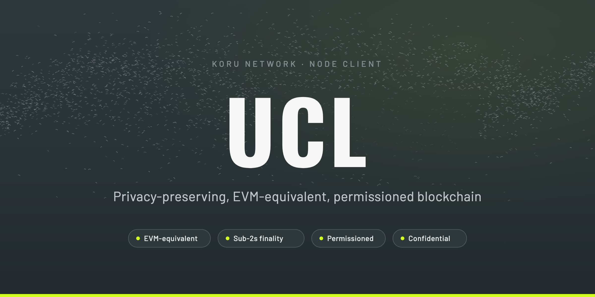

## UCL

UCL is the node client for Koru, a privacy-preserving, EVM-equivalent, permissioned blockchain for institutions and developers that need confidential transactions and controlled network access.

## Features

- **EVM-equivalent** – existing Ethereum contracts and tooling work unchanged.
- **Fast, deterministic finality** – IBFT proof-of-authority consensus with 1-second blocks and under 2-second end-to-end confirmation. Blocks are final immediately, with no reorgs.
- **Permissioned validators** – validators are known, identified operators, admitted by an on-chain vote of the existing validator set.
- **Confidential state** – balances are stored on-chain as ElGamal ciphertexts, and transfers are verified with zero-knowledge proofs, so validators can check correctness without seeing amounts. UTXO-style confidential tokens (pToken) live alongside the standard account model.
- **Predictable fees** – a fixed base fee instead of a floating one, so the same transaction costs the same from block to block.
- **No public mempool** – validators peer only with sentry nodes and are never exposed directly to the internet, removing the public transaction gossip that enables front-running and MEV.

Confidentiality protects values, not the transaction graph: addresses and timing remain visible on-chain.

## Network

| Network       | Chain ID  |
|---------------|-----------|
| `ucl-testnet` | `1618034` |

## Documentation 📝

For up-to-date documentation, visit [docs.koru.network](https://docs.koru.network/).

---

Copyright 2026 Koru Labs

Licensed under the Apache License, Version 2.0 (the "License");
you may not use this file except in compliance with the License.
You may obtain a copy of the License at

       http://www.apache.org/licenses/LICENSE-2.0

Unless required by applicable law or agreed to in writing, software
distributed under the License is distributed on an "AS IS" BASIS,
WITHOUT WARRANTIES OR CONDITIONS OF ANY KIND, either express or implied.
See the License for the specific language governing permissions and
limitations under the License.
